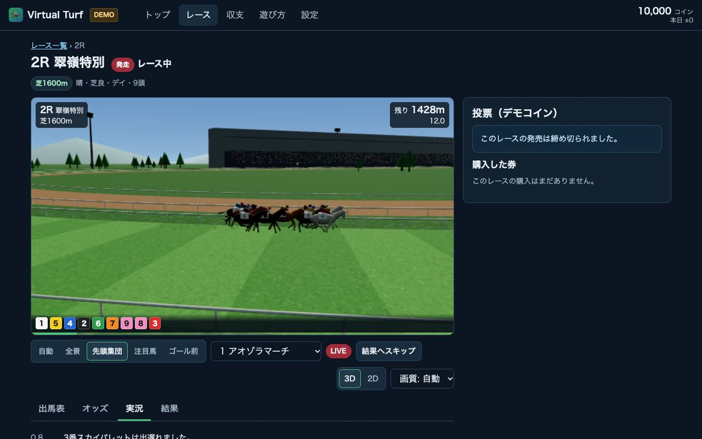
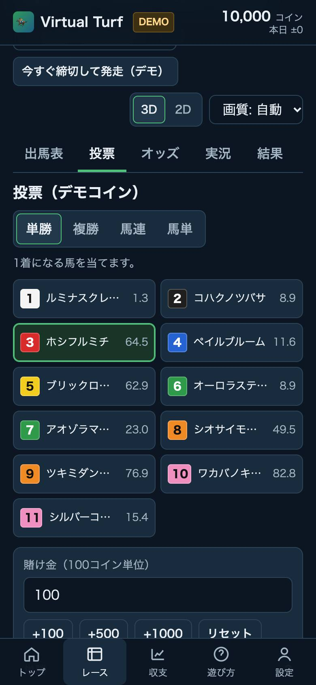

# Virtual Turf（仮称）

**▶ デモ：https://raphael816.github.io/virtual-turf/**

架空の競走馬・騎手・競馬場で遊ぶ **競馬シミュレーション（デモ）** です。
レース前に馬とオッズを検討して **デモコイン** で投票し、3Dのスポーツ中継風の映像で観戦し、結果・勝因・収支を振り返ります。

> ⚠️ **デモ専用**：デモコインは購入・換金・譲渡ができず、金銭的な価値はありません。
> 実際のお金での賭け・入金・出金は実装していません（[実際のお金を扱う前の確認事項](docs/03-legal-and-safety.md)）。
> 登場する馬・人物・競馬場・レースはすべて架空です。

| 3D観戦（PC） | トップ（スマートフォン） | 投票（スマートフォン） |
|---|---|---|
|  |  |  |

## できること

- **検討**：出馬表（脚質・適性・枠順・オッズ）、馬の能力レーダー、天候・馬場・時間帯
- **投票**：単勝・複勝・馬連・馬単。購入前に オッズ・想定払戻・購入後残高 を確認。パリミュチュエル方式のオッズ（発売中は変動 → 締切で確定）
- **観戦**：中継風の3D映像（望遠レンズのカメラワーク：全景・先頭集団・並走・正面・ゴール板・注目馬・自動）。断面スイープで作った馬と騎手、IKで蹄が滑らない襲歩、物理ベースの空と環境光。画質は 自動／低／中／高（高は被写界深度とモーションブラー）。2D上空図にも切替可。実況、残り距離、順位、リプレイ
- **振り返り**：着順・着差・上がり3F・払戻、勝因と人気馬の敗因の解説、結果に影響した要素の内訳
- **収支**：残高推移、レース別収支、購入履歴（購入時オッズ → 確定オッズ）
- **公正性**：結果を決める seed のハッシュを発売前に公開し、確定後に seed を公開して誰でも再計算できる。改ざんを検出できる監査ログ
- **責任ある利用**：年齢確認（自己申告）、1レース／1日の投票上限、損失上限、利用時間のお知らせ、一時休止・自己排除（期間中は解除不可）
- **アクセシビリティ**：axe-core（WCAG 2.1 AA）で全画面0件、キーボード操作、動きを減らす設定、3D非対応時の2D代替表示

## ドキュメント

1. [プロダクト企画（概要・MVP範囲・画面とフロー）](docs/01-product.md)
2. [実装方針と技術構成（シミュレーション・オッズ・3D・公正性・課題）](docs/02-architecture.md)
3. [実際のお金での賭けを検討する前の確認事項](docs/03-legal-and-safety.md)
4. [3D映像の品質改善（原因・改善内容・画質設定・素材の権利）](docs/04-visual-quality.md)

## 開発

```bash
npm install
npm run dev        # http://localhost:5173
npm test           # Vitest（62件）
npm run build      # 型チェック + 本番ビルド（dist/）
```

### GitHub Pages での公開

main に push すると `.github/workflows/pages.yml` がテスト・ビルドを行い、GitHub Pages にデプロイします（リポジトリ変数 `ENABLE_PAGES=true` で有効化済み）。
データは利用者のブラウザ内（localStorage）にのみ保存され、サーバーには送信されません。

## ロードマップ（ステップ実装）

| Step | 内容 | 状態 |
|---|---|---|
| 1 | 企画ドキュメント・プロジェクト雛形・CI | ✅ |
| 2 | レースシミュレーションエンジン（能力・展開・天候・馬場、シード検証） | ✅ |
| 3 | オッズ・券種の登録の仕組み・デモコイン台帳・責任ある利用・監査ログ | ✅ |
| 4 | 画面（トップ／遊び方／一覧／馬の詳細／確認／収支／設定）＋2D代替表示 | ✅ |
| 5 | 3D観戦（コース・観客席・馬・カメラ・砂煙・画質設定） | ✅ |
| 6 | 実況・振り返り解説・アクセシビリティ・公開の準備 | ✅ |

今後の候補：サーバー側でのレース実行（seed の秘匿）、3連複・3連単・ワイド、多言語対応、実機での性能チューニング。
実際のお金を扱う機能は、[確認事項](docs/03-legal-and-safety.md) を法務・運用担当が確認するまで着手しません。

## ディレクトリ構成

```
src/
  core/      DOMに依存しないロジック（乱数・コース・シミュレーション・オッズ・券種・台帳・責任ある利用・監査・実況・解説）
  data/      架空の馬・騎手・レース名
  render/    再生制御、2D上空図、3D（three/：環境・馬・演出・カメラ）
  ui/        画面（pages/）、ストア、スタイル
tests/       Vitest
docs/        企画・設計ドキュメント、スクリーンショット
```
